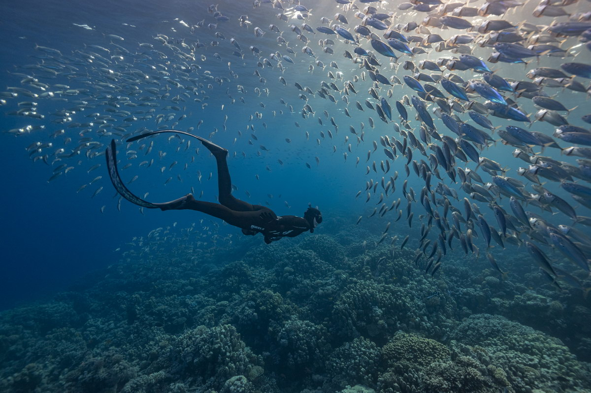

# Freitauchen für Anfänger (5-10 Meter)

## Motivation

Beim Thema Tauchen denken viele wahrscheinlich erstmal an **Scuba Diving**, also Tauchen mit Pressluftflasche, Neoprenanzug, Tauchcomputer, usw. Neben dem **Schnorcheln** an der Wasseroberfläche und Scuba Diving gibt es aber noch eine Zwischenvariante mit interessanten Eigenschaften. Das sogenannte **Freitauchen** (Freediving/Apnoe) wird mit Schnorcheleausrüstung ausgeführt und bietet einfachen Zugang in die dritte Dimension unter Wasser bis zu Tiefen von einigen Metern. Durch Luftanhalten kann für einen kurzen Zeitraum abgetaucht und die Unterwasserwelt entdeckt werden.

Durch Freitauchen kommt man in den Genuss eine Vielzahl von Lebewesen im Wasser, darunter z.B. verschiedenste Fische und Fischschwärme, Korallen, Meeresschildkröten, Tintenfische, Muränen, Mantas, uvm. zu beobachten. An manchen Urlaubsorten beginnen Korallenriffe bereits kurz nach dem Strand ab etwa zwei Metern Tiefe, so z.B. in Thailand oder Ägypten. Das Gefühl in 3D in die komplexe und abwechslungsreiche Unterwasserwelt abzutauchen ist unbeschreiblich. Viele Urlauber missen diese Erfahrung obwohl sie sich in unmittelbarer Nähe zu Korallenriffen befinden.

## Vorteile des Freitauchens

* Zugänglichkeit: mit wenig Ausrüstung können Küstenabschnitte und Korallenriffe betaucht werden. Auch ist nicht unbedingt eine Zertifizierung oder ein spezielles Training notwendig.
* Einfachheit: Maske und Schnorchel passen gut in's Gepäck. Es müssen keine Flaschen durch Dritte befüllt und bereitgestellt werden. Auf Grund des aktiveren Tauchstils im Vergleich zum Scuba Diving, ist meist kein Neoprenanzug erforderlich.
* Sicherheit: bei Tauchtiefen von 5-10 Metern kann jederzeit innerhalb von wenigen Sekunden schnell aufgetaucht werden ohne Gefahr zu laufen körperliche Schäden davonzutragen. So besteht nicht die Gefahr wie beim Scuba Diving, dass beim Auftauchen die Lunge platzen kann.
* Bezahlbarkeit: mit einer Taucherbrille beginnt der Spaß. Mehr als eine Maske, Schnorchel und Flossen braucht auch der fortgeschrittene Taucher nicht.

## Ausrüstung

Die Mindestausrüstung beim Freitauchen ist eine vernünftige **Tauchermaske**. Schwimmbrillen oder Masken mit Gläsern aus Plastik statt gehärtetem Glas sind nicht zu empfehlen. Wer eine Maske mitnimmt oder ausleiht, tut dies meist in Verbindung eines **Schnorchels**. Dieser lässt es zu, den Kopf dauerhaft unter Wasser zu halten und sorgt so für eine bessere Immersion, ist nicht unbedingt notwendig, empfehle ich aber. Praktisch aber verzichtbar sind beim Freitauchen ein Paar **Flossen**. Diese helfen Entfernungen mit weniger Aufwand zu bestreiten, horizontal als auch vertikal.

## Anleitung erste Schritte

Die genannten Schritte können auch z.B. im Springerbecken eines Schwimmbades durchgeführt werden. Am besten immer zusammen mit einer anderen Person. Voraussetzung dazu ist, dass die Maske sitzt und bereits durch den Schnorcheln während des Schwimmens längere Zeit problemlos geatment werden kann. Sollte die Maske beschlagen, abnehmen und einmal mit odentlich Spucke und Fingern auswischen, danach einmal kurz ausspülen.

### Schritt 1 – Schnorchel

Zu Beginn gilt es sich daran zu gewöhnen, dass sich der Schnorchel bei leichtem Abtauchen mit Wasser füllt. Der Schnorchel bleibt dabei im Mund und das Wasser kann beim Auftauchen einfach ausgeblasen werden. Dafür muss natürlich etwas Luft in der Lunge vorhanden sein. Verbleibt ein kleiner Rest Wasser im Schnorchel kann oft trotzdem schon vorsichtig eingeatmet und ein zweites Mal ausgestoßen werden (ggf. Schnorchel am untersten Punkt mit der Hand verengen). Ist dies geschafft, kann der Schnorchel auch bei Tauchtiefen von mehreren Metern dauerhaft im Mund verbleiben und man muss sich nicht mehr um ihn kümmern.

Als Übung kann in einem Schwimmbecken 0,5-1 Meter abgetaucht und ein paar Meter unter Wasser geschwommen werden.

### Schritt 2 – Abtauchen

Richtiges Abtauchen ist einfach und effizient. Ausgangsbasis ist die flache Position im Wasser, Gesicht nach unten, wie beim Schnorcheln üblich. Nach 1-2 tiefen Atemzügen den Oberkörper herunterklappen, so dass er im 90° Winkel zu den Beinen nach unten zeigt. Nun den Körper wieder gerade strecken, indem die Beine nach oben geklappt werden, so dass diese aus dem Wasser herausragen (ähnlich der Schwanzflosse eines Wals). Durch das erhöhte Gewicht außerhalb des Wassers gleitet der Körper wie von selbst kurzzeitig in die Tiefe.

### Schritt 3 – Druckausgleich

Wichtig beim Abtauchen ist der Durckausgleich über die Ohren. Ohne Druckausgleich bekäme man ab etwa 2 Meter Tiefe starke Schmerzen in den Ohren und letztlich würde das Trommelfell reißen. Grund ist die Kompression der Luft im Körper, die ausgeglichen werden muss. Grundvoraussetzung für den Druckausgleich ist, dass dieser über beide Ohren funktioniert. Dies kann einfach im Trockenen vorab einmal ausprobieren werden, indem bei geschlossenem Mund und zugehaltener Nase versucht wird auszuatmen, bzw. Druck aufzubauen bis sich beide Ohren "geöffnet" haben. Hierbei entweicht Druck über die Eustachische Röhren zu den Ohren und unter Wasser wird so der Druck dem Umgebungsdruck angeglichen. Klappt das nicht an Land, sollte ein Arzt konsultiert werden, der prüfen kann ob z.B. etwas verstopft ist.

Druckausgleich muss mehrfach alle paar Tiefenmeter gemacht werden (ca. alle zwei Meter). Es darf nicht gewartet werden, bis es beginnt zu schmerzen, sondern muss durchgeführt werden schon sobald sich etwas Druck aufgebaut hat. Bei Schmerzen sofort wieder ein Stück auftauchen. Das ist eine Frage der Übung und Erfahrung und ist recht schnell verinnerlicht. Anfänger dürften zügig in der Lage sein auf 5-7 Meter hinabzutauchen, wofür 2-3 Druckausgleiche nötig sind.

Für Fortgeschrittene: Wenn die Maske gut sitzt kann versucht werden einen Druckausgleich ohne Zuhalten der Nase durchzuführen, indem durch die Nase in die Maske ausgeatmet wird. So kann auch der hohe Anpressdruck der Maske auf das Gesicht ab etwa 7 Meter verringert werden. Sollte dieser Ausgleich ohne mit der Hand die Nase zuzuhalten nicht funktionieren, sitzt wahrscheinlich die Maske nicht fest genug (bzw. man ist noch nicht tief genug) und der Druck entweicht über die Maske.

### Schritt 4 – Lungenvolumen

Ich empfehle einmal in ruhiger Umgebung auszuprobieren, wie sich der Körper mit unterschiedlich stark gefüllten Lungen verhält. Beispiel Springerbecken im Schwimmbad: tief einatmen, dann tief ausatmen und der Körper sinkt automatisch nach unten. Für den Weg nach oben vom Grund mit den Füßen abstoßen um Energie zu sparen. So kann man auch auf dem Grund laufen oder sich hinsetzen, kann jedoch weniger lange die luft anhalten.

Bei komplett gefüllten Lungen spürt man deutlichen Auftrieb und muss ständig Energie aufwenden, um in einer gewissen Tiefe zu bleiben (Tarierung). Um dies zu einem gewissen Grad zu vermeiden kann die Lunge nur zu 1/2 bis 2/3 gefüllt werden. Oder man findet mit voller Lunge ein Objekt in der Zieltiefe an dem man sich festhalten kann und bekommt so zusätzliche Zeit unter Wasser, da kaum Energie aufgewendet wird. Profis setzen auch manchmal Gewichtsgürtel ein. Man kann alternativ auch einen Stein vom Grund als Gewicht ein paar Meter mitnehmen. Erst ab einer Tiefe von ca. 10 Metern wird die Luft in der Lunge so weit komprimiert, dass der Auftrieb kaum noch spürbar ist. Das betrifft aber eher Apnoe-Profis.

### Schritt 5 – Luftanhalten

Im letzten Schritt kann getestet werden, wie lange unter Wasser verbleieben werden kann mit nur einem Atemzug. Hier gibt es verschiedene Techniken der Apnoe-Sportler um z.B. durch Atemübungen und Meditation die Herzfrequenz und den Energieverbrauch zu senken. Auch der Tauchreflex spielt eine Rolle. Sehr wichtig hier ist, nicht zu hyperventilieren vor dem Abtauchen, da dies zu einem Blackout führen kann. Zwei tiefe Atemzüge reichen aus.

Zur Übung kann auch statisches Apnoe geübt werden, d.h. ohne Bewegung mit Kopf unter Wasser im Becken verbleiben und die Zeit messen. Dies immer nur unter Aufsicht durchführen.

### Mögliche Gefahren

Die zwei größten Gefahren beim Freitauchen sind die Folgenden:

* Boote: beim Auftauchen kann es passieren, dass schnell ein Boot auf einen zukommt mit drohender Kollision. Motorboote hört man schon aus großer Enternung unter Wasser, Segelboote kaum. Ich empfehle regelmäßig über Wasser Ausschau zu halten nach Wasserfahrzeugen. Auch ein Kanu kann unangenehm sein bei einer Kollision. Ist ein Boot in der Nähe, versuchen auf sich aufmerksam zu machen, durch Signalfarbe an der Ausrüstung (Schnorchel), ggf. Winken und vorerst an der Oberfläche bleiben um die Situation zu beobachten. Sollte ein Boot trotzdem weiter auf einen zukommen wegschwimmen oder wieder tief genug abtauchen. Schiffsschrauben sind sehr gefährlich. Ich selbst gucke beim Schnorcheln etwa jede Minute in alle Richtungen aus dem Wasser. Auch direkt beim Auftauchen kann schon unter Wasser mittels einer Drehung in mehrere Richtungen die Oberfläche geprüft werden.
* Netze +co: ein weiterer Aspekt der lebensgefährlich werden kann ist, sich unter Wasser in etwas verheddern und nicht schaffen sich zeitnah zu befreien. Deshalb bei Leinen, Netzen und Wasserpflanzen unter Wasser besonders vorsichtig sein und besser Abstand halten. Höhlen und andere Bereiche bei denen der Weg nach oben nicht mehr direkt möglich ist generell vermeiden. Erfahrene Freitauchen führen oft ein Messer mit sich u.a. um sich besser aus solchen Situationen befreien zu können.

Weitere Gefahren können die Folgenden sein:

* Strömung: auf Abdrift achten und Tauchausflüge so planen, dass gegen die Strömung gestartet und mit der Strömung zurückgeschwimmen wird. Bei zu starker Strömung abbrechen. Auf Tidenzeiten achten.
* Quallen: beim Schnorcheln nicht nur nach unten, sondern regelmäßig auch nach vorne und seitlich gucken, um z.B. Quallen und andere Hindernisse frühzeitig auszumachen. Kontakt vermeiden, manche Quallen besitzen ein Gift, das zu starken Schmerzen bis zur Bewusstlosigkeit und Tod führen kann.

Freitaucher in guter Verfassung können an der Küste problemlos alleine tauchen, trotzdem ist zu empfehlen immer mit einem Tauch-Buddy unterwegs zu sein, um sich gegenseitig helfen zu können.
